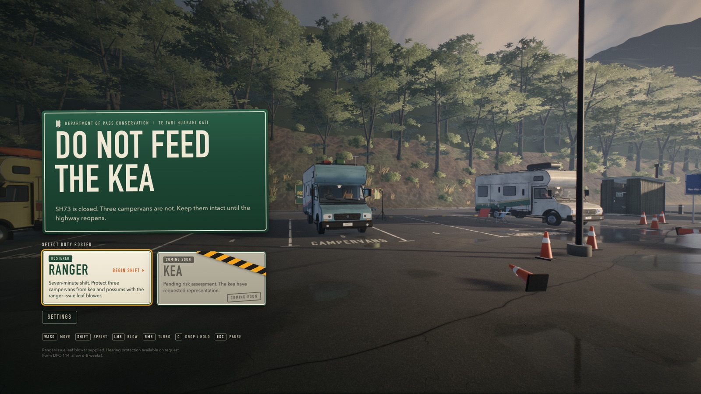
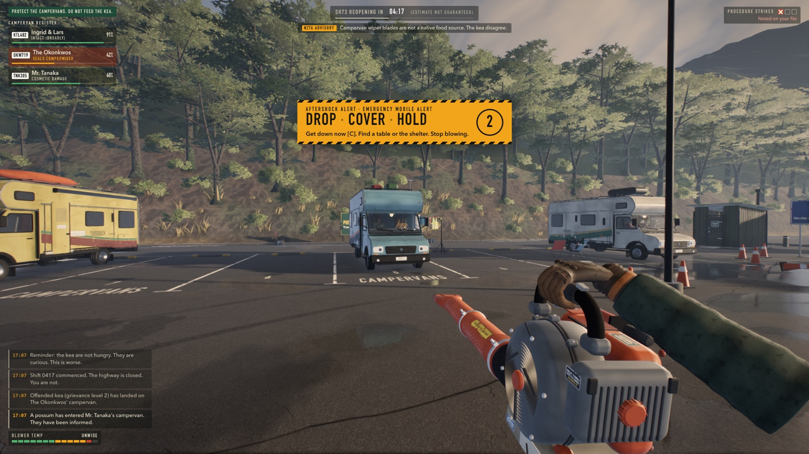
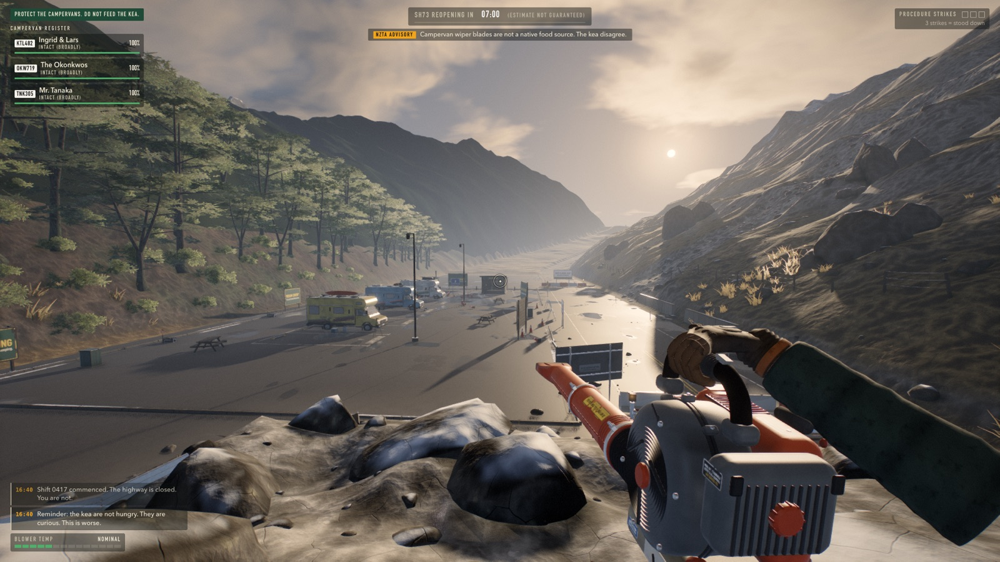
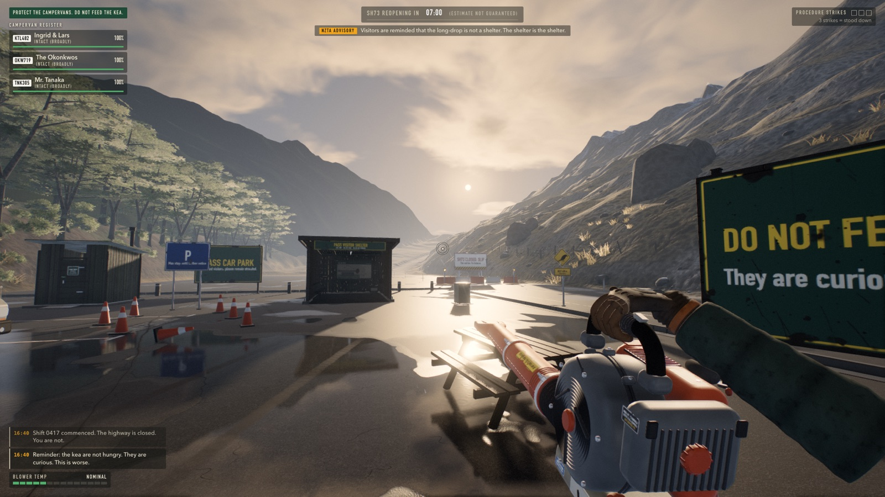
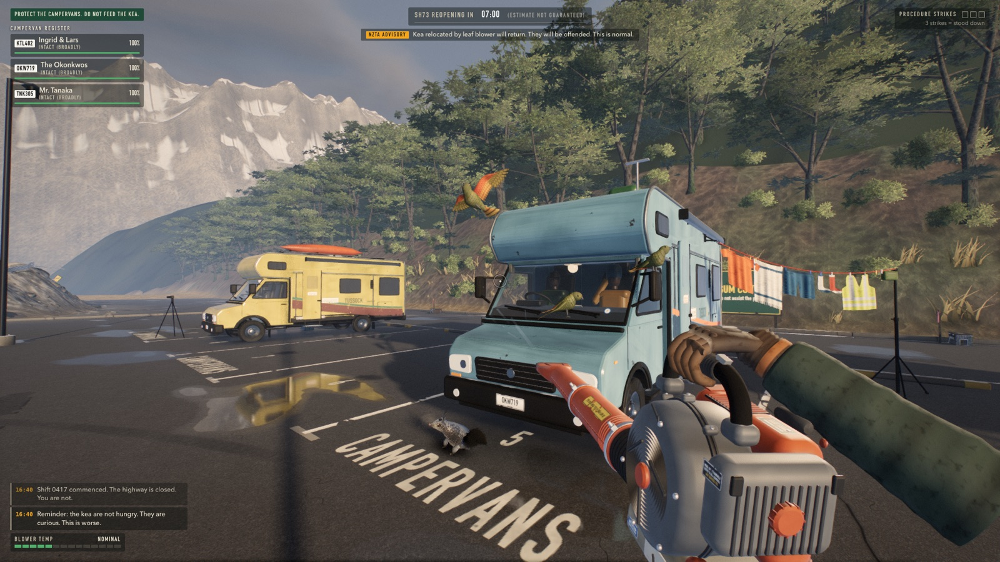
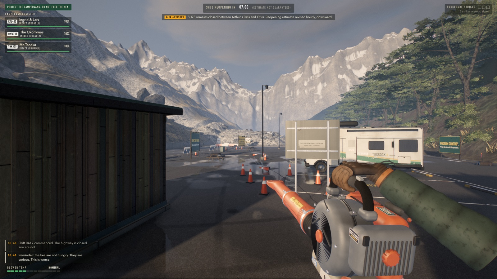

# DO NOT FEED THE KEA

**A deadpan New Zealand comedy shooter, armed with a leaf blower.**

SH73 is closed. A slip has come down across the highway at an alpine pass, it is aftershock season, and three rental
campervans are stranded in the car park. You are the ranger on duty. Your equipment is one ranger-issue leaf blower.
Keep the campervans intact until the highway reopens, while:

- **kea** (alpine parrots) land on the vans and strip the seals, wipers and mirrors. Blow them away. They come back offended.
- **possums** waddle out of the beech forest and try to get into the vans. Blow them along the wet asphalt into the trap boxes.
- **aftershocks** trigger an official alert. Drop, cover and hold, or collect a procedure strike.

Nobody gets hurt. The humour is carried by dry official signage and HUD text from the Department of Pass Conservation.

**▶ Play in your browser: https://cgbarlow.github.io/kea-game/** (desktop Chrome or Edge, hardware GPU)

The whole game is **one HTML file of about 1.1 MB** (`index.html`, about 350 KB gzipped). It contains no image, 3D model,
texture or audio files: the terrain, beech forest, campervans, blower, kea, possums, signage, materials, sky and sound
are all generated by code when the page loads.

| | |
|---|---|
|  |  |
|  |  |
|  |  |
|  |  |

Screenshots are real-GPU captures (Apple M4, high quality) of this build, taken with the project's own capture tool.

---

## How to play

| Action | Control |
|---|---|
| Look | Mouse (click to capture the pointer) or right stick |
| Move / sprint | W A S D or left stick / Shift |
| Blow | Left mouse button. The blower heats up; overheat it and it needs a forced cool-down. |
| Turbo | Right mouse button. Stronger, hotter, discouraged by the Department. |
| Drop, cover and hold | C (or Ctrl) during an aftershock alert. Stay crouched, still and not blowing. Near a picnic table or the shelter counts as exemplary. |
| Pause / settings | Esc |
| FPS readout | F3 or backtick (`` ` ``) |

**Win:** the highway reopens when the 7-minute shift timer runs out. **Lose:** a campervan's integrity reaches zero
("A tourist has left a review"), or you collect three procedure strikes and are stood down.

The title screen has a duty roster: **Ranger** is the game. **Kea** mode is listed as *coming soon, pending risk
assessment*. A playable kea mode is planned for version 2.

### Performance and settings

The game picks a quality tier at start-up with a quick GPU test, then adapts the tier and render resolution while you
play to hold 60 fps. Settings (Esc) let you fix the **quality tier** (Auto, Low, Medium, High) and the **render
resolution** (Auto, 100%, 85%, 70%, 50%), plus sensitivity, field of view, volume and invert Y.

Measured with the project's benchmark tool at 1920×1080:

| Machine | Auto quality | High quality |
|---|---|---|
| AMD Radeon 8060S (Strix Halo laptop, Linux, plugged in) | about 4 ms per frame | about 7 ms per frame |
| Apple M4 Mac mini (base 10-core GPU) | about 12 ms per frame (low tier, about 60% resolution) | about 130 ms per frame |

On weaker GPUs such as a base M4, auto mode trades sharpness for frame rate; high quality needs a stronger GPU.

URL options for testing: `?q=low|med|high` fixes the tier, `?dynres=0` turns off automatic resolution, `?fps=1` starts
with the FPS readout on.

---

## Building from source

Requires Node.js 18 or newer.

```sh
npm install
node build.mjs            # → dist/index.html (single file, fails if over 2 MB or if it contains binary blobs)
cp dist/index.html index.html
```

Useful tools (see `tools/README.md`): `node tools/capture.mjs` (real-GPU screenshots), `node tools/bench.mjs`
(fly-through benchmark), `node tools/playtest.mjs --script playtest.json` (scripted playtest bot).

Project layout:

- `src/main.js` boots every system in order. `src/modules/` holds the game: terrain, car park, campervans, blower,
  kea, possums, game rules, HUD and audio.
- `src/cookbook/` is the shared rendering cookbook (post-processing, soft shadows, atmosphere, procedural materials
  and weathering, planar puddle reflections, quality scaling).
- `SPEC.md` (design), `ART.md` (art direction) and `OWNERS.md` (module plan) are the documents the game was built from.

---

## How it was made

This game was built with **Claude Code** running **Claude Opus 5.5**, using the
[**`onefile-aaa`**](https://github.com/elcronos/whiteout-onefile) skill by Camilo Pestana, the skill behind
[WHITEOUT](https://github.com/elcronos/whiteout-onefile). The skill turns a one-line concept into a single-file 3D
browser game with a multi-agent pipeline: specification, look development, parallel module builders, a blind
screenshot critic, a playtest bot and a performance gate.

The concept prompt was:

> A first-person shooter. A deadpan New Zealand comedy at a quake-closed alpine pass car park in aftershock season: armed
> with a ranger-issue leaf blower, protect three stranded tourists' campervans from kea (flying, non-lethal: blown away,
> they return offended) and possums (ground, blown into trap boxes) until the highway reopens; aftershock alerts force
> you to drop, cover and hold. Humour is carried by dry official signage and HUD text.

After the pipeline, the game got a performance pass to reach 60 fps on a base Apple M4 (a rewritten adaptive-quality
controller, a cheaper low tier, light culling), a render-resolution setting, an FPS readout, and playtest fixes for the
blower's feel, its force on kea and possums, and mouse capture on Linux.

## Credits

- **Game:** Chris Barlow, with Claude (Anthropic).
- **`onefile-aaa` skill** (rendering cookbook, build template and tools): Camilo Pestana,
  [elcronos/whiteout-onefile](https://github.com/elcronos/whiteout-onefile), MIT.
- **Light culling** (`src/perf/lightcull.js`): adapted from WHITEOUT by Camilo Pestana, MIT.
- **[three.js](https://threejs.org)** r180: the three.js authors, MIT.
- **Procedural geometry and water code** (portions of `src/cookbook/geo/` and `water/`): Maksymilian Dendura, MIT.

Full licence texts for third-party code are in [`THIRD_PARTY_NOTICES.md`](THIRD_PARTY_NOTICES.md).

Kea (*Nestor notabilis*) are endangered and protected in New Zealand. Please do not feed them, and do not point leaf blowers at them.

## Licence

[MIT](LICENSE) © 2026 Chris Barlow
